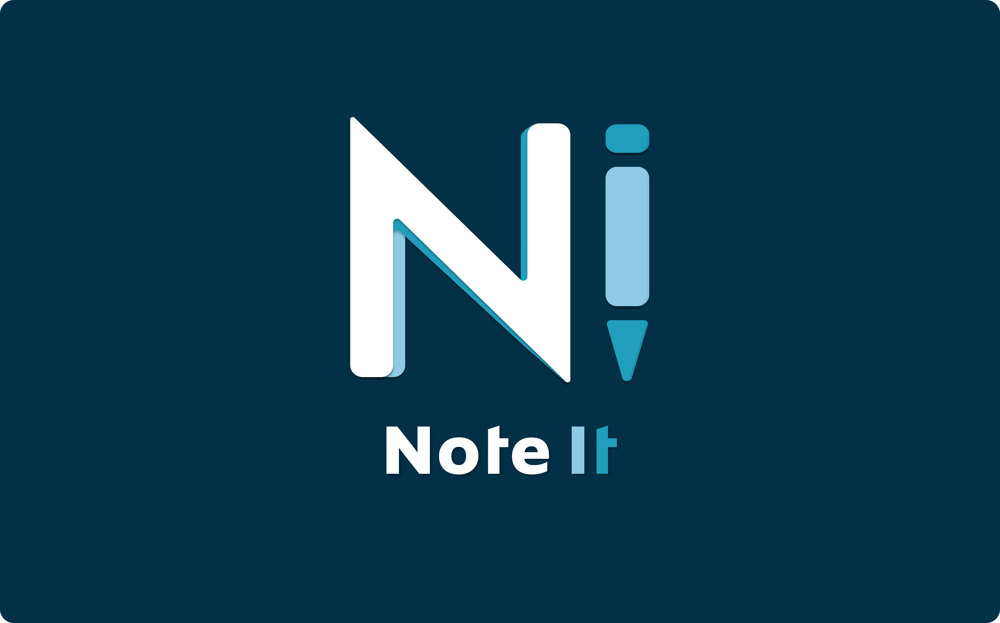

# Note It

**NoteIt is a feature-packed, note-taking extension with OCR support for chrome.  
You can take notes, convert images to text, download notes to pdf, and more.**

   

---

## Features

- ✍ Take notes in rich formatting.

  - ✅ Markdown support

- 👀 Open the extension as a pop-up or re-sizable window.
- 🎨 Three different themes: Light, dark & dim.
- 📸 Take a screenshot of the active tab and:

  - ✂️ Copy the cropped image
  - 📜 Convert to text (OCR support)
  - ✔ Download the cropped image

- 💾 Save notes on your local machine

  - 🗃 Notes folder
  - ⭐ Make notes as favorite

- 📁 Download note in PDF format
- 🗄 Convert your images to text (this feature works only when the extension is in window mode)

### [Check video](https://www.youtube.com/watch?v=jxBAMwxbk78 "https://www.youtube.com/watch?v=jxBAMwxbk78")

## Contributors

 

🎨 Designed by : [Altin Smaili](https://www.figma.com/file/h66qGHcw4DzCZMotoqioTV/Note-It?node-id=2%3A121)

## Main libraries used

- [React](https://reactjs.org/)
- [Tiptap](https://tiptap.dev/)
- [tesseract.js](https://tesseract.projectnaptha.com/)
- [pdfmake](https://pdfmake.org/#/)
- [html-to-pdfmake](https://github.com/Aymkdn/html-to-pdfmake)

## CI and releases

Pull requests targeting `main` and pushes to `main` run CI tests and a production build using Node.js 24.

Automatic publishing is disabled. Neither pushing to `main` nor pushing a tag creates a GitHub release or publishes to the Chrome Web Store. Tag-driven publishing to both destinations is planned as a separate change.
